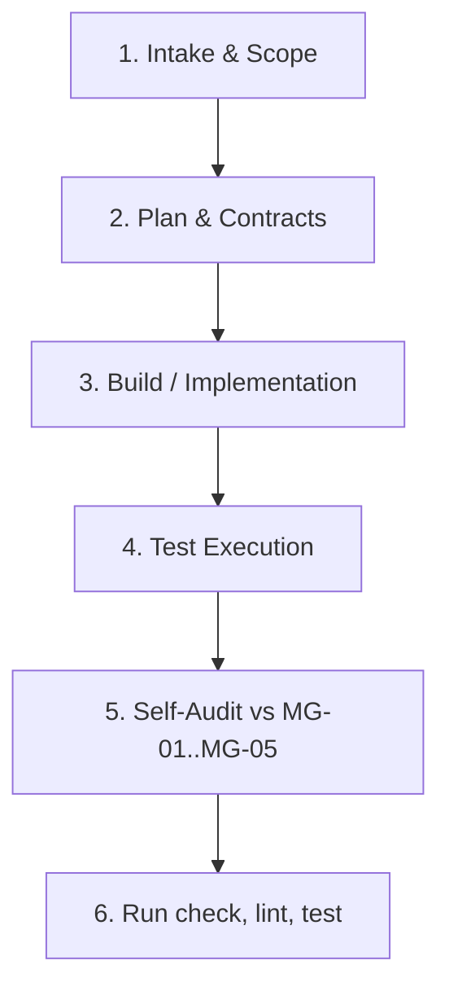

# AGENTS.md — Universal Agent Guide for What's For Dinner (WFD)

> **Audience:** Any AI coding assistant, autonomous agent, language model, or IDE outside of Cursor (e.g., Claude Code, GitHub Copilot, Windsurf, Aider, OpenCode, Cline, Antigravity, or custom agent harnesses).  
> **Authority:** This document is the primary entrypoint and translation layer for non-Cursor agents. All referenced Architecture Decision Records (ADRs) under [`adrs/`](./adrs/) and domain rules under [`.cursor/rules/`](./.cursor/rules/) are strictly binding regardless of your development environment.

---

## 1. Project Overview & Mental Model

**What's For Dinner (WFD)** is an offline-first, anonymous-first recipe book with a local recommendations engine and optional AI/cloud enhancements.

### Core Product Principles

- **Offline-First & Anonymous-First ([ADR-001](./adrs/ADR-001-product-operating-model.md)):** The core application must function completely offline and without an account once cached in the browser. Users can create, view, edit, search, tag, soft-delete, and restore recipes with zero dependency on network, Supabase auth, or OpenAI APIs.
- **Local Data as Center of Gravity ([ADR-002](./adrs/ADR-002-local-data-ownership.md)):** Saved recipes, cooking history, user preferences, and cached suggestion artifacts belong in browser-local storage via **Dexie (IndexedDB)**.
- **Cloud & AI as Optional Enhancements ([ADR-004](./adrs/ADR-004-account-and-cloud-enhancement-model.md), [ADR-007](./adrs/ADR-007-ai-provider-contract.md)):**
  - **Supabase** provides optional authentication, cross-device synchronization, and backup for registered users. Logged-out and offline recipe workflows must never be blocked by Supabase connectivity or auth state.
  - **OpenAI** provides optional recipe suggestions, idea expansion, and cooking assistance. When AI is unavailable or offline, the UI degrades gracefully with informative states instead of throwing unhandled exceptions.
- **Preferences vs Recommendations ([ADR-009](./adrs/ADR-009-recommendations-engine-inputs.md)):**
  - User preferences, dietary restrictions, and cooking constraints **only shape AI prompts and suggestions**.
  - The **recommendations engine** is purely local and deterministic: it ranks and surfaces recipes the user has **already saved** using local metadata and `checkout_history`. Preferences do **not** filter local recommendations.
- **Serverless & Secret Safety ([ADR-006](./adrs/ADR-006-serverless-and-secret-boundary.md)):** Deployment targets serverless runtimes (Netlify adapter configured; Cloudflare/edge portability discipline). Secrets and private environment variables must **never** leak into client bundles, stores, or `.svelte` components.

---

## 2. Navigating the Cursor Heritage Outside Cursor

This repository was originally created and tailored around Cursor IDE conventions. Much of its agentic infrastructure lives in `.cursor/`:

```text
.cursor/
├── rules/             # 25+ domain, architectural, and workflow rules (*.mdc)
├── agents/            # Multi-agent role contracts (orchestrator, planner, builder, tester, validator)
└── orchestrations/    # Task folders containing manifests, plans, build logs, and reports
```

### How Non-Cursor Agents Must Treat `.cursor/` Content

1. **`.cursor/rules/*.mdc` are Universal Markdown Rules:**  
   Files ending in `.mdc` are standard Markdown files with YAML frontmatter specifying file globs (`globs`) and activation (`alwaysApply: true/false`).  
   **Every agent must treat these rules as binding project requirements.** When you inspect or modify files matching a rule's scope, read the corresponding `.mdc` file directly with your file reading tool.  
   Complete catalog: [`.cursor/rules/index.md`](./.cursor/rules/index.md).

2. **Role Contracts in `.cursor/agents/*.md`:**  
   Defines the responsibilities and minimum read sets for 5 agent roles: `orchestrator`, `planner`, `builder`, `tester`, and `validator`. Whether running as an orchestrated multi-agent system or as a single LLM assistant, you must adhere to the role boundaries and quality checks defined there.  
   Full index: [`.cursor/agents/INDEX.md`](./.cursor/agents/INDEX.md).

3. **Orchestrations in `.cursor/orchestrations/{task-id}/`:**  
   Durable task folders that record plans, acceptance criteria, test matrices, build logs, and validation reports. For structured tasks, you should maintain or inspect these folders.  
   Workflow guide: [`docs/ORCHESTRATED_DEVELOPMENT.md`](./docs/ORCHESTRATED_DEVELOPMENT.md).

### Precedence of Authority

When project documents provide conflicting guidance, resolve in this strict order:

1. **Accepted ADRs** in [`adrs/`](./adrs/) and [`adrs/GOVERNANCE.md`](./adrs/GOVERNANCE.md).
2. **Merge-Ready Workflow Gates (MG-01–MG-05)** in [`.cursor/rules/workflow-gates.mdc`](./.cursor/rules/workflow-gates.mdc) and [`docs/validation-checklist.md`](./docs/validation-checklist.md).
3. **Role Contracts** in [`.cursor/agents/`](./.cursor/agents/).
4. **Domain Rules** in [`.cursor/rules/*.mdc`](./.cursor/rules/).
5. **Topic Documentation** in [`docs/`](./docs/) and component/library `README.md` files.
6. **Root `README.md`**.

_Note: Only **Accepted** ADRs are binding. Never treat **Proposed**, **Deprecated**, or **Superseded** ADRs as active rules._

---

## 3. Essential Developer & Verification Commands

Always use **`pnpm`** as the package manager:

| Task                     | Command                         | Notes                                                              |
| :----------------------- | :------------------------------ | :----------------------------------------------------------------- |
| **Install dependencies** | `pnpm install`                  | Uses `pnpm-lock.yaml`                                              |
| **Start dev server**     | `pnpm run dev`                  | Runs Vite dev server                                               |
| **Type & Svelte check**  | `pnpm run check`                | Runs `svelte-kit sync` + `svelte-check --tsconfig ./tsconfig.json` |
| **Lint & format check**  | `pnpm run lint`                 | Runs `prettier --check . && eslint .`                              |
| **Format code**          | `pnpm run format`               | Auto-formats code with Prettier (`tabWidth: 2`, tabs)              |
| **Run all tests**        | `pnpm run test`                 | Runs Vitest in batch mode (`--run`) across all projects            |
| **Run server tests**     | `pnpm test -- --project server` | Runs Node environment unit/integration tests                       |
| **Run client tests**     | `pnpm test -- --project client` | Runs browser component tests via Vitest Playwright provider        |
| **Build project**        | `pnpm run build`                | Builds production bundle with configured adapter                   |
| **Preview build**        | `pnpm run preview`              | Previews production build                                          |

> [!IMPORTANT]  
> Always run `pnpm run check`, `pnpm run lint`, and `pnpm run test` before claiming any implementation is complete.

---

## 4. Codebase Architecture & Directory Map

```text
whats-for-dinner/
├── adrs/                      # Architecture Decision Records (governance source of truth)
│   ├── INDEX.md               # Catalog of all ADRs and statuses
│   ├── GOVERNANCE.md          # ADR authoring, lifecycle, and conflict rules
│   └── ADR-*.md               # Individual ADRs (ADR-001 through ADR-017)
├── docs/                      # Topic-specific architecture, checklists, and guides
│   ├── validation-checklist.md       # Canonical audit checklist (MG-01 to MG-05 & domain checks)
│   ├── readme-adr-alignment-gaps.md  # Known architectural discrepancies backlog
│   ├── ORCHESTRATED_DEVELOPMENT.md   # Comprehensive agent workflow guide
│   ├── test-matrix-template.md       # Test matrix layers and reporting template
│   └── tanstack-query.md             # TanStack Query + runes integration patterns
├── .cursor/                   # Cursor rules, agent definitions, and task orchestrations
│   ├── rules/                 # Machine-readable development rules (*.mdc)
│   ├── agents/                # Agent role definitions (*.md)
│   └── orchestrations/        # Task folders and run states
├── src/
│   ├── lib/
│   │   ├── api/               # Mandatory home for domain and service modules
│   │   │   ├── <domain>/      # e.g., recipe, ai, auth, session, sync, preferences
│   │   │   │   ├── *.schemas.ts  # Zod schemas (SoT for validation and data shapes)
│   │   │   │   ├── *.types.ts    # Types derived via z.infer<typeof Schema>
│   │   │   │   ├── *.model.ts    # Domain logic, transformers, entity factories
│   │   │   │   ├── *.service.ts  # Domain operations and API communication
│   │   │   │   └── index.ts      # Domain barrel export
│   │   │   └── README.md      # API layer guidelines and rules
│   │   ├── db.ts              # Single authoritative Dexie database instance
│   │   ├── db/                # Dexie database helpers (mutations, transactions, sync bridges)
│   │   ├── stores/            # Reactive Dexie-backed readable stores (createLiveQueryStore)
│   │   │   ├── _utils.ts      # Store utilities (createLiveQueryStore)
│   │   │   └── README.md      # Store layer guidelines and examples
│   │   ├── ui/                # Headless UI primitives built with bits-ui and TailwindCSS
│   │   │   └── README.md      # Component library guidance
│   │   ├── utils/             # Domain-agnostic pure utilities ONLY (no API or auth code)
│   │   ├── types.ts           # Cross-cutting non-domain TypeScript types
│   │   ├── server/            # Server-only utilities (OpenAI SDK, private helpers)
│   │   └── openai/            # OpenAI prompt templates and structured JSON helpers
│   ├── routes/                # SvelteKit routable pages, layouts, and endpoints
│   │   ├── api/               # Server-only HTTP endpoints (secret-bearing & AI endpoints)
│   │   ├── +layout.svelte     # App root layout
│   │   └── ...                # App routes
│   ├── hooks.server.ts        # Server-side hooks (SSR auth, locals.supabase, safeGetSession)
│   └── service-worker.js      # Two-tier cache service worker (static shell & GET requests)
├── static/                    # Static assets
├── tests/                     # Test fixtures and shared testing utilities
├── svelte.config.js           # SvelteKit configuration (adapter-netlify)
├── vite.config.ts             # Vite configuration with Vitest multi-project setup
└── tsconfig.json              # TypeScript configuration
```

---

## 5. Non-Negotiable Architecture Invariants

Every agent working on this codebase must uphold these core architectural rules:

### A. Local Data & Dexie Ownership ([ADR-002](./adrs/ADR-002-local-data-ownership.md), [`.cursor/rules/local-data-dexie-ownership.mdc`](./.cursor/rules/local-data-dexie-ownership.mdc))

- **Single Database:** `src/lib/db.ts` exports the single `db` instance. Never instantiate a second `Dexie` instance.
- **Reactive Reads:** Query tables using Dexie's `liveQuery` or `createLiveQueryStore` in `src/lib/stores/_utils.ts`. UI components must subscribe through store runes (e.g., `let recipes = $derived($recipesStore)`).
- **Centralized Mutations:** Never scatter raw `db.*.put/update/delete` calls across arbitrary Svelte components or pages. Route all writes through store or domain service helpers.
- **Transactions:** Multi-table writes must run within `db.transaction('rw', [tables...], async () => { ... })`.
- **Read-Only Views:** Treat store snapshots as read-only. Persistence must only happen via Dexie methods inside domain/store helpers.

### B. Schema-Led Contracts & Type Safety ([ADR-008](./adrs/ADR-008-schema-led-domain-contracts.md), [`.cursor/rules/schema-and-type-safety.mdc`](./.cursor/rules/schema-and-type-safety.mdc))

- **Zod as Source of Truth:** All persisted entities, HTTP API payloads, and external JSON shapes must have authoritative Zod schemas under `src/lib/api/<domain>/*.schemas.ts`.
- **Derived Types:** Derive TypeScript types using `z.infer<typeof Schema>`. Never hand-craft duplicate `interface` or `type` definitions that mirror schemas.
- **Strict Validation:** Use `.strict()` on all new or modified object schemas to reject unexpected keys.
- **Boundary Validation:** Always parse untrusted data (network JSON, user input, AI output) using `.safeParse()` at system boundaries.
- **Placement Rule:** Domain code belongs in `src/lib/api/<domain>/`. Generic pure utilities go in `src/lib/utils/`. Do not export shared domain types from `.svelte` files.

### C. Serverless & Secret Boundaries ([ADR-006](./adrs/ADR-006-serverless-and-secret-boundary.md), [ADR-007](./adrs/ADR-007-ai-provider-contract.md), [`.cursor/rules/serverless-compatibility.mdc`](./.cursor/rules/serverless-compatibility.mdc))

- **No Secrets in Client Code:** Never import private environment variables or server libraries in client modules, stores, or `.svelte` files.
- **Private Imports:** Private secrets (`OPENAI_API_KEY`) must only be imported in server modules using `$env/static/private`.
- **Public Variables:** Only environment variables prefixed with `PUBLIC_` (e.g., `PUBLIC_SUPABASE_URL`, `PUBLIC_SUPABASE_PUBLISHABLE_KEY`) may be exposed to the browser.
- **Serverless Discipline:** Avoid Node-only APIs (`fs`, `child_process`, etc.) in application code. Rely on standard Web APIs (`fetch`, `Request`, `Response`, `Crypto`) compatible with Cloudflare Workers and Netlify Edge functions.

### D. AI Integration Boundary ([ADR-007](./adrs/ADR-007-ai-provider-contract.md), [`.cursor/rules/ai-integration-boundary.mdc`](./.cursor/rules/ai-integration-boundary.mdc))

- **Preferred Path:** Use the OpenAI **Responses API** with Zod structured output (`zodTextFormat`) via `src/lib/api/ai/ai.model.ts`.
- **Deprecated Legacy:** `chat.completions.create` in `src/lib/server/openai.ts` is deprecated. Never add new Chat Completions call sites.
- **Zod Schema Compatibility:** Schemas passed to `zodTextFormat` must be plain JSON-schema compatible (primitives, objects, arrays, `.describe()`). Do not use `.transform()`, `.pipe()`, or heavy `.refine()` directly on the structured response schema; perform secondary transformations in a follow-up step.
- **Preferences:** Recipe generation and AI prompts must inject user preferences (dietary restrictions, allergies, cooking constraints).
- **Graceful Failure:** If OpenAI keys are missing or the API fails, return a 503 / `OPENAI_DISABLED` envelope; never crash or leave the user in an infinite loading state.

### E. Svelte 5 Runes & UI Conventions ([ADR-013](./adrs/ADR-013-ui-component-library-bits-ui.md), [ADR-014](./adrs/ADR-014-semantic-html-and-accessibility.md), [`.cursor/rules/svelte-5-ui-conventions.mdc`](./.cursor/rules/svelte-5-ui-conventions.mdc))

- **Svelte 5 Runes:** Always use `<script lang="ts">`. Use `$state()` for local reactive state, `$derived()` for computed state, and `$props()` for props.
- **No Legacy `$: ` Syntax:** Never use legacy Svelte 3/4 `$: ` reactive statements.
- **Side Effects:** Reserve `$effect()` strictly for true side effects (DOM interaction, logging, imperative integration). Never use `$effect` to compute derived values that can be written with `$derived()`.
- **UI Components:** Use **bits-ui** headless primitives in `src/lib/ui/`, styled with **TailwindCSS 4**. Avoid adding alternative headless component libraries.
- **Accessibility:** Use semantic HTML (`<main>`, `<nav>`, `<button>`), accessible form controls, and explicit `aria-*` attributes.
- **Async UI:** Render `{ data, loading, error }` envelopes for store and query results. Reserve `{#await}` for load-returned promises and always supply the `:catch` block.

### F. Lint & Code Quality ([`.cursor/rules/lint-and-code-quality.mdc`](./.cursor/rules/lint-and-code-quality.mdc))

- **Indentation:** Use **tabs** (`tabWidth: 2`) configured in [`.prettierrc`](./.prettierrc). Do not mix spaces and tabs.
- **Import Order:** External packages → internal aliases (`$lib/...`) → local relative modules (`./...`). Use `import type` for type-only imports.
- **Documentation:** Provide enterprise JSDoc comments on exported production TypeScript functions, interfaces, and Svelte `@component` blocks per [`.cursor/rules/documentation-conventions.mdc`](./.cursor/rules/documentation-conventions.mdc).

---

## 6. Operating Outside Cursor: Workflows for LLMs & Agents

Whether you are an agent in Claude Code, GitHub Copilot, Windsurf, Aider, Antigravity, or a CLI harness, use the following operational models:

### Mode 1: Single-Agent Workflow (CLI / Single LLM Session)

When operating as a single agent handling a feature, bug fix, or refactor, you must self-enforce the separation of concerns across phases:



1. **Intake & Scope:**
   - Classify the task risk tier:
     - `small`: copy changes, isolated bugfix, low-risk UI tweak.
     - `medium`: new component, route update, store changes.
     - `large`: multi-file feature, sync/auth, offline behavior, AI integration, or ADR-governed changes.
   - For `medium` and `large` changes, do not jump straight into editing files.
2. **Plan & Contracts:**
   - Consult relevant ADRs in [`adrs/INDEX.md`](./adrs/INDEX.md).
   - Check [`docs/readme-adr-alignment-gaps.md`](./docs/readme-adr-alignment-gaps.md) for known drift.
   - Define concrete acceptance criteria (`AC-01`, `AC-02`, etc.).
   - Identify touched files and interface changes.
3. **Build:**
   - Implement the code following the invariants in Section 5.
   - Only edit files in your planned scope.
4. **Test:**
   - Add or update Vitest tests in `src/` to cover all acceptance criteria.
   - Run tests: `pnpm run test`.
5. **Self-Audit:**
   - Audit your work against [`docs/validation-checklist.md`](./docs/validation-checklist.md).
   - Ensure you meet Merge-Ready Gates **MG-01** through **MG-05** (see Section 7).
6. **Tooling Verification:**
   - Run `pnpm run check` and `pnpm run lint`. Ensure zero errors.

---

### Mode 2: Multi-Agent Orchestration Workflow

If your environment supports multi-agent execution (subagents, swarms, or scripted handoffs), follow WFD's formal task-folder orchestration model documented in [`docs/ORCHESTRATED_DEVELOPMENT.md`](./docs/ORCHESTRATED_DEVELOPMENT.md).

#### The 5 Roles

| Role             | Contract File                                                        | Responsibilities                                                                                                                                                                        |    Modifies Code?    |
| :--------------- | :------------------------------------------------------------------- | :-------------------------------------------------------------------------------------------------------------------------------------------------------------------------------------- | :------------------: |
| **Orchestrator** | [`.cursor/agents/orchestrator.md`](./.cursor/agents/orchestrator.md) | Coordinates lifecycle, initializes task folder, updates `task-manifest.json`, enforces gates, and requests human approval.                                                              |        **No**        |
| **Planner**      | [`.cursor/agents/planner.md`](./.cursor/agents/planner.md)           | Analyzes requirements, checks ADRs, authors `plan.md`, `acceptance-criteria.md`, and `test-matrix.md` (planned).                                                                        |        **No**        |
| **Builder**      | [`.cursor/agents/builder.md`](./.cursor/agents/builder.md)           | Implements exact planned changes, adheres to domain rules, and records progress in `build-log.md`.                                                                                      |       **Yes**        |
| **Tester**       | [`.cursor/agents/tester.md`](./.cursor/agents/tester.md)             | Writes and runs Vitest specs, maps ACs to tests, and completes `test-report.md` and `test-matrix.md` (actual).                                                                          | Tests & harness only |
| **Validator**    | [`.cursor/agents/validator.md`](./.cursor/agents/validator.md)       | Performs fresh-context audit against [`docs/validation-checklist.md`](./docs/validation-checklist.md) and produces `validation-report.md` (**PASS**, **PASS_WITH_NOTES**, or **FAIL**). |        **No**        |

#### Initializing an Orchestrated Task Folder

1. Create directory `.cursor/orchestrations/{task-id}/` by copying [`.cursor/orchestrations/_template/`](./.cursor/orchestrations/_template/).
2. Initialize `task-manifest.json` with the exact matching `task_id`, `objective`, and `risk_tier`.
3. Follow the canonical lifecycle:
   $$\text{Orchestrator} \rightarrow \text{Planner} \rightarrow \text{Builder} \rightarrow \text{Tester} \rightarrow \text{Validator} \rightarrow \text{Orchestrator (Gate 6)}$$
4. If Validator yields `FAIL`, route back to Builder with required remediations.

---

## 7. Merge-Ready Verification Gates (MG-01 through MG-05)

Before claiming any task is complete, ready to merge, or ready for PR, you must satisfy the 5 merge-ready checks:

|   Gate    | Title                | Requirement                                                                                                                                                                   | Verification                                                                     |
| :-------: | :------------------- | :---------------------------------------------------------------------------------------------------------------------------------------------------------------------------- | :------------------------------------------------------------------------------- |
| **MG-01** | **Alignment Gaps**   | Any architectural drift from Accepted ADRs must be remediated or explicitly documented in [`docs/readme-adr-alignment-gaps.md`](./docs/readme-adr-alignment-gaps.md).         | Check touched areas against alignment gaps backlog.                              |
| **MG-02** | **ADR Compliance**   | If introducing or altering durable architecture, auth, sync, AI provider, or offline data ownership, an ADR in `adrs/` must be created or updated.                            | Verify an Accepted or Proposed ADR covers the change.                            |
| **MG-03** | **Validation Audit** | Cross-cutting audit completed against [`docs/validation-checklist.md`](./docs/validation-checklist.md) (offline continuity, anonymous use, schema boundaries, accessibility). | All applicable checklist rows must pass.                                         |
| **MG-04** | **Test Evidence**    | Acceptance criteria mapped to Vitest specs; tests executed and passing.                                                                                                       | `test-report.md` completed (orchestrated) or test output provided in PR/handoff. |
| **MG-05** | **Tooling**          | Code formatting, linting, and type checking pass cleanly.                                                                                                                     | `pnpm run check` and `pnpm run lint` succeed with exit code 0.                   |

> [!CAUTION]  
> Builder, Tester, and Planner agents must **never** claim a task is "merge-ready" or "ready to merge". Only the Validator (verdict) and Orchestrator/Human (Gate 6 approval) may declare a task complete.

---

## 8. Svelte MCP Tooling (When Available)

If your host environment has access to the **Svelte MCP server** (e.g., in Claude Desktop, Cursor, or MCP-enabled tools), execute Svelte tasks following the protocol in [`.cursor/rules/svelte-mcp-workflow.mdc`](./.cursor/rules/svelte-mcp-workflow.mdc):

1. **`list-sections`:** Run first to discover official Svelte 5 and SvelteKit documentation topics relevant to your task.
2. **`get-documentation`:** Retrieve the full text of the discovered documentation sections before writing code.
3. **Write / Edit:** Implement your components using Svelte 5 runes and bits-ui.
4. **`svelte-autofixer`:** Run this tool on every authored or edited `.svelte` file before finishing. Loop until no issues or suggestions remain.
5. **`playground-link`:** Only call when specifically requested by the human user. Never call if code was written directly into repository files.

_(If the Svelte MCP server is not available in your environment, consult [`.cursor/rules/svelte-5-ui-conventions.mdc`](./.cursor/rules/svelte-5-ui-conventions.mdc) and [`docs/references.md`](./docs/references.md).)_

---

## 9. Comprehensive Rule & Topic Directory

Direct mapping between engineering topics and their canonical documentation:

| Concern                       | Primary Cursor Rule                                                                                        | Authoritative ADR / Document                                                                                                     |
| :---------------------------- | :--------------------------------------------------------------------------------------------------------- | :------------------------------------------------------------------------------------------------------------------------------- |
| **Architecture & Governance** | [`.cursor/rules/adr-compliance.mdc`](./.cursor/rules/adr-compliance.mdc)                                   | [`adrs/INDEX.md`](./adrs/INDEX.md), [`adrs/GOVERNANCE.md`](./adrs/GOVERNANCE.md)                                                 |
| **Offline-First Foundation**  | [`.cursor/rules/offline-first-development.mdc`](./.cursor/rules/offline-first-development.mdc)             | [ADR-001](./adrs/ADR-001-product-operating-model.md), [ADR-010](./adrs/ADR-010-offline-cache-and-service-worker.md)              |
| **Offline Connectivity UX**   | [`.cursor/rules/offline-connectivity-capability.mdc`](./.cursor/rules/offline-connectivity-capability.mdc) | [ADR-001](./adrs/ADR-001-product-operating-model.md), [`docs/readme-adr-alignment-gaps.md`](./docs/readme-adr-alignment-gaps.md) |
| **Dexie & Local Storage**     | [`.cursor/rules/local-data-dexie-ownership.mdc`](./.cursor/rules/local-data-dexie-ownership.mdc)           | [ADR-002](./adrs/ADR-002-local-data-ownership.md), [`src/lib/stores/README.md`](./src/lib/stores/README.md)                      |
| **Zod & Domain Contracts**    | [`.cursor/rules/schema-and-type-safety.mdc`](./.cursor/rules/schema-and-type-safety.mdc)                   | [ADR-008](./adrs/ADR-008-schema-led-domain-contracts.md), [`src/lib/api/README.md`](./src/lib/api/README.md)                     |
| **AI Integration & Prompts**  | [`.cursor/rules/ai-integration-boundary.mdc`](./.cursor/rules/ai-integration-boundary.mdc)                 | [ADR-007](./adrs/ADR-007-ai-provider-contract.md), [ADR-003](./adrs/ADR-003-ai-suggestion-lifecycle.md)                          |
| **Supabase & Cloud Boundary** | [`.cursor/rules/supabase-enhancement-boundary.mdc`](./.cursor/rules/supabase-enhancement-boundary.mdc)     | [ADR-004](./adrs/ADR-004-account-and-cloud-enhancement-model.md), [ADR-005](./adrs/ADR-005-sync-and-conflict-resolution.md)      |
| **Serverless & Secrets**      | [`.cursor/rules/serverless-compatibility.mdc`](./.cursor/rules/serverless-compatibility.mdc)               | [ADR-006](./adrs/ADR-006-serverless-and-secret-boundary.md)                                                                      |
| **Svelte 5 Runes & UI**       | [`.cursor/rules/svelte-5-ui-conventions.mdc`](./.cursor/rules/svelte-5-ui-conventions.mdc)                 | [ADR-013](./adrs/ADR-013-ui-component-library-bits-ui.md), [ADR-014](./adrs/ADR-014-semantic-html-and-accessibility.md)          |
| **Frontend Data Flow**        | [`.cursor/rules/frontend-data-flow.mdc`](./.cursor/rules/frontend-data-flow.mdc)                           | [ADR-016](./adrs/ADR-016-frontend-data-flow-and-svelte-dx.md), [`docs/tanstack-query.md`](./docs/tanstack-query.md)              |
| **Lint & TypeScript Style**   | [`.cursor/rules/lint-and-code-quality.mdc`](./.cursor/rules/lint-and-code-quality.mdc)                     | [`.cursor/rules/documentation-conventions.mdc`](./.cursor/rules/documentation-conventions.mdc)                                   |
| **Testing & Test Matrix**     | [`.cursor/rules/test-matrix.mdc`](./.cursor/rules/test-matrix.mdc)                                         | [`docs/test-matrix-template.md`](./docs/test-matrix-template.md)                                                                 |
| **Workflow Gates & PRs**      | [`.cursor/rules/workflow-gates.mdc`](./.cursor/rules/workflow-gates.mdc)                                   | [`docs/validation-checklist.md`](./docs/validation-checklist.md), [`docs/pr-and-commit-guide.md`](./docs/pr-and-commit-guide.md) |
| **Orchestration Guide**       | [`.cursor/rules/orchestration-artifacts.mdc`](./.cursor/rules/orchestration-artifacts.mdc)                 | [`docs/ORCHESTRATED_DEVELOPMENT.md`](./docs/ORCHESTRATED_DEVELOPMENT.md)                                                         |

---

## 10. Summary Checklist for Agents Before Concluding Work

Before reporting completion to the human user, review this final sanity check:

- [ ] No existing architectural files were moved or deleted.
- [ ] Core recipe book operations remain functional offline and without authentication.
- [ ] All database mutations go through Dexie store/domain helpers in `src/lib/stores/` or `src/lib/db/`.
- [ ] Domain code and Zod schemas reside in `src/lib/api/<domain>/`.
- [ ] No server secrets (`OPENAI_API_KEY`, private tokens) appear in client code or `.svelte` files.
- [ ] Svelte components use runes (`$state`, `$derived`, `$props`, `$effect`) and avoid legacy `$:`.
- [ ] Tests covering your changes were added or updated and run via `pnpm run test`.
- [ ] `pnpm run check` passes with zero type or Svelte errors.
- [ ] `pnpm run lint` passes with zero ESLint or Prettier violations.
