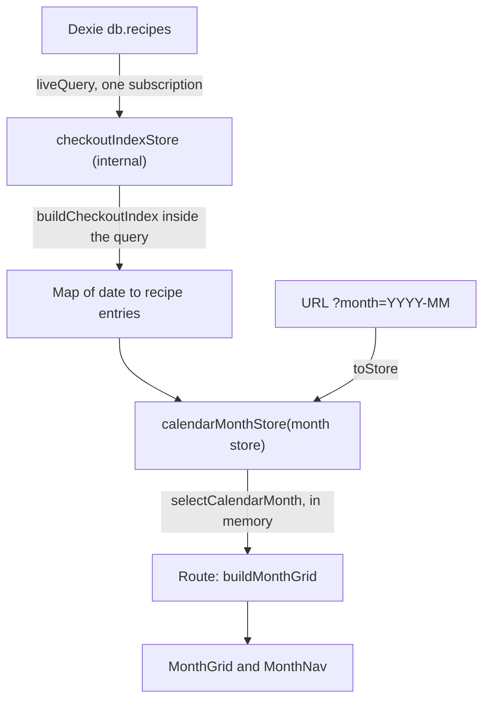

# Calendar

A month-at-a-time view of **when recipes were made**, built from `SavedRecipe.checkout_history`. Route: `/calendar`.

**Roadmap envelope:** [ADR-012 §A](../../adrs/ADR-012-feature-roadmap-boundaries.md). **Orchestration record:** `.cursor/orchestrations/calendar-page/` (plan, acceptance criteria, build log with measurements).

## What it does

- Shows one month as a classic grid: weekday names across the top, every day numbered, blank cells for days outside the month, today marked.
- Lists every recipe made on a day as a single-line pill that truncates with an ellipsis. Each pill is a link to `/recipes/{id}`. The full title is available via the `title` attribute and the link text.
- Navigation: previous month, next month, **Today**, and month and year selectors. It is a normal page: no dialogs or popovers.
- Display-only. Checkout dates are still added and removed from the recipe page.

## Offline, anonymous, AI (ADR-012 cross-feature invariant 1)

| Condition                  | Behavior                                                                                                                                                                                                 |
| -------------------------- | -------------------------------------------------------------------------------------------------------------------------------------------------------------------------------------------------------- |
| Offline                    | Fully functional for in-app use: reads only Dexie; no network. A hard reload or direct URL to a month never loaded as a document fails offline (see [GAP-027](../readme-adr-alignment-gaps.md#gap-027)). |
| Anonymous (no session)     | Fully functional. Shows this device's recipes.                                                                                                                                                           |
| AI disabled or unreachable | No dependency.                                                                                                                                                                                           |
| Signed in with cloud sync  | Shows whatever sync has already merged into Dexie. The calendar adds no sync semantics ([ADR-005](../../adrs/ADR-005-sync-and-conflict-resolution.md)).                                                  |

**Local-only, no cloud table.** The calendar has no Dexie table of its own, no Supabase table or migration, no `src/routes/api/**` route, and imports nothing from `$lib/api/cloud`, `$lib/server`, `$lib/openai`, or `$lib/recommendations` ([ADR-009](../../adrs/ADR-009-recommendations-engine-inputs.md): it reads the same field the recommendations engine reads but never influences ranking).

## URL contract

`/calendar?month=YYYY-MM`

- The URL is the single source of truth for the visible month, so back/forward, bookmarks, and refresh work.
- Missing or invalid values (`2026-13`, `garbage`, `2026-1`) fall back to the current month in the local time zone. There is no redirect and no error.
- Previous, next, and Today are real `<a href>` links. The month and year selectors call `goto` with the same URL shape.

## Data flow

Design decisions (all measured; see below):

- **Read lazily.** `liveQuery` stores start on first subscribe and stop on last unsubscribe. Nothing is read until `/calendar` is mounted, and nothing is cached outside Dexie.
- **One re-read per change to `recipes`, never per month navigation.** The index covers the whole history. Changing month is a pure in-memory slice with no Dexie access.
- **Do not retain recipe documents.** The index is built _inside_ the live query, so ingredients and instructions are garbage-collected immediately. For that reason the calendar does not derive from `unsortedRecipesStore`, which keeps every full recipe alive. This is a deliberate exception to "prefer derived stores over a second `liveQuery`" in `.cursor/rules/local-data-dexie-ownership.mdc`.
- **Slim index.** One shared `{ id, title }` object per recipe is reused across all of its dates. Day lists are unsorted until the visible month is selected; only those days are sorted.
- **Create `calendarMonthStore` once** and drive it with a month store. Svelte unsubscribes the previous `$store` before subscribing to its replacement, so creating a store per month would stop and restart the `liveQuery` on every navigation (a Dexie re-read and a loading flash).

## Dates and time zones

`checkout_history` values are calendar dates (`YYYY-MM-DD`), not instants, and carry **no time of day**.

- Never build days with `new Date('YYYY-MM-DD')` or serialize via `toISOString()`. Parsing as UTC shifts the day in negative-offset zones. Calendar code uses integers, or `Date` objects built with `setUTCFullYear` and read with `getUTC*`.
- "Today" comes from `isoDateToday()` (local zone).
- Legacy entries written by older clients may be timestamps. The calendar normalizes with the existing `toIsoDate` (bucketing by date part, skipping unparseable values) and **never writes**. The recipe detail page performs the storage migration when a recipe is opened.
- Within a day, recipes sort by title (locale-aware), then id. Position in `checkout_history` is never an ordering signal.
- Labels use `DateFormatter` from `@internationalized/date` with a **fixed `en-US` locale** and UTC-zoned formatting, so server and browser render identical text (the route is server-rendered; Dexie data only appears client-side).
- Week start is Sunday. `buildMonthGrid` and `getWeekdayLabels` both accept `weekStart: 1` for Monday-first; no UI exposes it yet.

## Which recipes appear

Only active recipes: `!deleted_at && is_current` (the same predicate as `recipesStore`). A recipe moved to trash disappears from the calendar and reappears if restored. A recipe checked out twice on one day appears once.

## States

| State                | Behavior                                                                                         |
| -------------------- | ------------------------------------------------------------------------------------------------ |
| Loading              | Centered spinner; month heading and navigation still render.                                     |
| Error                | Error name and message; no grid.                                                                 |
| Month has no recipes | Full grid plus "No recipes were made in {Month YYYY}."                                           |
| Nothing ever made    | Full grid plus a note linking to My Recipes.                                                     |
| Busy day             | Every recipe is listed; the row grows. There is no "+N more" because there is no detail surface. |

## Layout and accessibility

- Semantic `<table>` with `table-fixed w-full`, so seven equal columns at every width and pills truncate instead of widening the page. Rows use content height; the page scrolls vertically.
- One `h1` ("Calendar"), the month heading as `h2` (`aria-live="polite"`), a screen-reader-only `<caption>`, `<th scope="col">` headers exposing full weekday names (short labels from `sm`, single letters below), day numbers in `<time datetime>`.
- Today is marked by a filled circle and outline (not colour alone) plus `aria-current="date"`.
- Navigation is a `<nav>` with real links and native, labelled `<select>`s; everything is keyboard operable. The sidenav link has an accessible name when collapsed ([ADR-014](../../adrs/ADR-014-semantic-html-and-accessibility.md)).
- Reduced motion: no transitions on month change.

**Known limitations**

- **Phone widths.** Below 640 px the app's existing collapsed side-rail overlays the left edge of every page, hiding the first calendar column. This is a layout issue for the whole app, accepted for now because tablets and laptops are the target and a layout overhaul is planned. The grid itself fits and is tested at 320 and 375 px in isolation.
- Pills are 24 px tall, which meets the WCAG 2.2 AA minimum target size (2.5.8) but not the 44 px target ADR-014 prefers where feasible; 44 px is not feasible in a seven-column grid with several recipes per day. A one-off axe-core run against the production build found no violations in the calendar content at 768, 1024, and 1280 px (nav expanded and collapsed). That audit is not part of CI, and no screen-reader pass has been done; accessibility is otherwise covered structurally by component tests.

## Performance and the escalation ladder

The calendar started with the simplest approach (**A**) and has an upgrade path that has **not** been needed. Escalate only when measurement shows a problem.

| Step   | What                                                                                                                                                                                                             | Status       |
| ------ | ---------------------------------------------------------------------------------------------------------------------------------------------------------------------------------------------------------------- | ------------ |
| **A**  | Full `recipes` read, slim index built in memory, month sliced in memory.                                                                                                                                         | **Shipped.** |
| **E1** | Add a multi-entry index `*checkout_history` to `recipes` (`version(4)`), so a month query loads only recipes made that month. IndexedDB maintains it on every write path: no hooks, backfill code, or sync step. | Not built.   |
| **E2** | Dedicated `recipe_checkouts` table (`[recipe_id+date], date`) kept in sync with Dexie hooks, backfilled on upgrade and rebuilt after sync.                                                                       | Not built.   |

The seam that makes this cheap is `calendarMonthStore(month$)`: components import only it, so E1 or E2 would replace its internals without touching the UI.

**Triggers (E1 is warranted if any is exceeded on 2,000 recipes × ~30 checkouts):** first render over 250 ms on desktop or over 600 ms at 4× CPU throttle; `toArray()` plus index build over 100 ms; retained heap over about 10 MB.

**Measured** (synthetic library: 2,000 recipes, ~5 KB of text each, 30 checkouts each spread over ~6 years = 60,000 dates; real IndexedDB; headless Chromium):

| Metric                                                        | 1× CPU                    | 4× CPU throttle |
| ------------------------------------------------------------- | ------------------------- | --------------- |
| `db.recipes.toArray()`                                        | ~50 ms                    | ~81 ms          |
| `buildCheckoutIndex`                                          | ~18–20 ms                 | ~46 ms          |
| `selectCalendarMonth` (first call)                            | ≤ 4.5 ms                  | < 1 ms          |
| Retained heap with the index (after GC)                       | 0.7–0.8 MB                | n/a             |
| Page load to first grid, production build (includes app boot) | 170–282 ms (median ≈ 230) | 440–558 ms      |
| Same, **empty library** (app-boot baseline)                   | 118–201 ms                | 260–273 ms      |
| Calendar-attributable first-render cost (difference)          | ≈ 70–100 ms               | ≈ 190–290 ms    |

**Verdict: E1 trigger not fired.** One 1× production sample (282 ms) exceeds 250 ms only if app boot is counted against the calendar; the budget did not specify. All 4× samples are under 600 ms. Run-to-run variance is about ±50 ms. Re-measure if libraries grow well beyond 2,000 recipes or checkout counts per recipe rise sharply.

If E1 or E2 is ever built: (1) normalize `checkout_history` in the Dexie upgrade first, because an index range query cannot see legacy timestamp-style entries that `toIsoDate` currently repairs on read; (2) record the change in ADR-012's notes; (3) E2 additionally needs an accepted ADR amendment and a parity test against the derived index.

## Module map

| Path                                   | Role                                                                                                                                         |
| -------------------------------------- | -------------------------------------------------------------------------------------------------------------------------------------------- |
| `src/lib/api/calendar/`                | Zod schemas, types, pure model (`calendar.model.ts`), labels (`calendar.labels.ts`). See its [README](../../src/lib/api/calendar/README.md). |
| `src/lib/stores/calendar.ts`           | `checkoutIndexStore` (internal) and `calendarMonthStore(month$)` (public).                                                                   |
| `src/lib/ui/calendar/MonthGrid.svelte` | Semantic month table and recipe pills.                                                                                                       |
| `src/lib/ui/calendar/MonthNav.svelte`  | Previous, next, Today, month and year controls.                                                                                              |
| `src/routes/calendar/+page.svelte`     | Route: URL to month store, states, composition.                                                                                              |
| `src/lib/ui/asidenav/asidenav.svelte`  | "Calendar" link after Recommendations.                                                                                                       |

## Tests

| Layer               | Location                                                                              | Covers                                                                                                                    |
| ------------------- | ------------------------------------------------------------------------------------- | ------------------------------------------------------------------------------------------------------------------------- |
| Unit (Node)         | `src/lib/api/calendar/calendar.model.test.ts`, `calendar.labels.test.ts`              | Month math, index, month slice, grid for leap/6-week/Monday-first cases, time-zone independence, a 60,000-date smoke test |
| Unit (Node)         | `src/lib/stores/calendar.test.ts`                                                     | Store envelope, slim entries, zero extra reads across 12 month changes (Dexie `liveQuery` stubbed)                        |
| Component (browser) | `src/lib/stores/calendar.svelte.test.ts`                                              | Real Dexie: load, month navigation without a loading flash, live add, edit, delete, restore                               |
| Component (browser) | `src/lib/ui/calendar/*.svelte.test.ts`, `src/lib/ui/asidenav/asidenav.svelte.test.ts` | Table structure, `aria-current`, links, truncation, layout at 320–1920 px, selectors, Tab order, sidenav link             |

Run the model tests under other time zones with, for example, `TZ=Pacific/Auckland pnpm exec vitest run --project server src/lib/api/calendar`. The browser tests need Playwright Chromium (`pnpm exec vitest run --project client src/lib/ui/calendar`).

## Follow-ups

Gaps recorded at approval (validation verdict: PASS_WITH_NOTES). None block the feature. Full detail: `.cursor/orchestrations/calendar-page/validation-report.md`.

| #   | Follow-up                                                                                                                                                                                                                                                                              | Severity | Where tracked                                                                          |
| --- | -------------------------------------------------------------------------------------------------------------------------------------------------------------------------------------------------------------------------------------------------------------------------------------- | -------- | -------------------------------------------------------------------------------------- |
| 1   | Offline hard reload or direct URL to a month never loaded as a document fails (service worker caches documents per full URL; also affects `/recipes?sort=…`). Fix in `src/service-worker.js` with its own plan.                                                                        | Minor    | [GAP-027](../readme-adr-alignment-gaps.md#gap-027), relates to GAP-009                 |
| 2   | Below 640 px the app-wide side-rail overlay hides the first calendar column. Accepted exception; fix with the planned layout overhaul, not a calendar workaround.                                                                                                                      | Minor    | [GAP-028](../readme-adr-alignment-gaps.md#gap-028) (acceptance criterion AC-16 waived) |
| 3   | Clamp the representable month range to years 1–9999 (or disable the Next/Previous links at the ends). At `?month=9999-12` the Next link targets year 10000, fails URL validation, and falls back to the current month; labels for year 0 and 10000 are wrong. Practically unreachable. | Low      | This list                                                                              |
| 4   | Add `@fileoverview` / `@module` headers to `src/lib/stores/calendar.ts` and `src/lib/api/calendar/calendar.types.ts` (`.cursor/rules/documentation-conventions.mdc`; sibling files share the same omission).                                                                           | Low      | This list                                                                              |
| 5   | Revisit native month/year `<select>` versus the bits-ui `Select` wrapper used on `/recipes` (ADR-013 consistency) during the UI overhaul. The native choice was approved in the plan under ADR-014.                                                                                    | Low      | This list                                                                              |
| 6   | Accessibility regression coverage: add `axe-core` as a devDependency with a component test (needs approval), do a screen-reader pass, and reconsider 44 px targets for the month controls (currently the app-standard 36 px on `md+`; pills are 24 px).                                | Info     | This list                                                                              |
| 7   | First-render budget wording: the E1 trigger (250 ms desktop) did not say whether app boot counts. One production sample was 282 ms at 1× CPU including boot. Re-measure if libraries grow well past 2,000 recipes.                                                                     | Info     | This list; see _Performance_                                                           |
| 8   | Offline and logged-out behavior and performance numbers rest on scripted manual runs, not committed tests. Adopt a standalone Playwright suite if recurring coverage is wanted.                                                                                                        | Info     | This list                                                                              |
| 9   | The human-skipped test `src/routes/recipes/new/import-url-boundary.test.ts` ("needs further evaluation") is unrelated to the calendar and still needs a decision.                                                                                                                      | Info     | This list                                                                              |

## Out of scope (future)

Editing checkout dates from the calendar, day-detail pages, week or agenda views, export or print, sharing ([ADR-012](../../adrs/ADR-012-feature-roadmap-boundaries.md): needs a successor ADR), and meal planning for future dates (ADR-012 §D).
